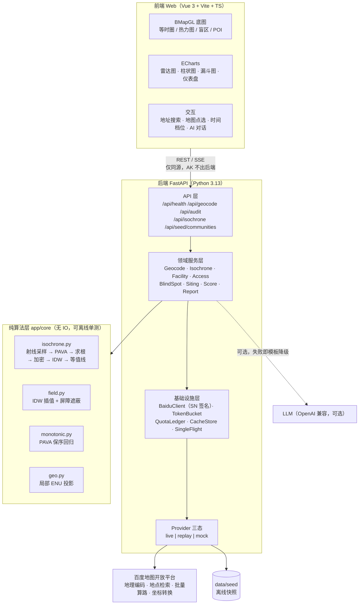

# 「15 分钟生活圈」智能体检与规划助手

> **2026 上海开源软件应用创新大赛** · 开源 AI 工具赛道 · 百度地图企业命题
> 许可证：**Apache-2.0**（见 [LICENSE](LICENSE)）

**一句话价值**：输入任意一个社区中心点，用**真实路网步行耗时**（而不是直线距离）算出 5/10/15 分钟等时圈，
自动统计 8 类民生设施覆盖、标出「1 km 内没有菜市场 / 药店 / 小学」的**服务盲区**，
并给出可解释的综合体检分与补点建议——把人工普查式的「15 分钟生活圈」评估，变成 35 秒内可复现的自动化体检。

> 传统评估用直线缓冲圈，会把河流、铁路、封闭小区、天桥背后的区域误判为「已覆盖」。
> 本项目用「射线采样真实算路 + IDW 耗时场重建 + marching squares 提等值线」还原真实可达范围，
> 并把红绿灯、绕行造成的不确定性量化成可见的**不确定带**。

---

## 📺 演示视频与交付物

| 内容 | 链接 |
| --- | --- |
| **演示视频**（2 分 53 秒） | **[▶ B站在线观看](https://www.bilibili.com/video/BV1sGJt6qEUQ/)** · [下载 20 MB](https://github.com/aurasuisui/15min-life-circle/releases/download/v1.0/demo-15min-life-circle.mp4) |
| 作品介绍（含实测数据） | [docs/report/作品介绍.md](docs/report/作品介绍.md) |
| 真实对比测试报告 | [docs/report/真实对比测试报告.md](docs/report/真实对比测试报告.md) |
| 现场实测原始数据（轨迹 GPX） | [docs/report/field-data/](docs/report/field-data/) |
| 技术设计文档（5 篇） | [docs/design/](docs/design/) |

> 视频内容：赛题与团队 → 等时圈算法管线 → 设施覆盖与数据清洗 → 盲区识别 →
> **现场实测验证（高驰手表 2417 个轨迹点，零越界）** → AI 层与工程治理。

---

## 目录

- [1. 效果预览](#1-效果预览)
- [2. 核心特性](#2-核心特性)
- [3. 系统架构](#3-系统架构)
- [4. 快速开始](#4-快速开始)　←　**评审方从这里开始**
- [5. 环境变量说明](#5-环境变量说明)
- [6. 目录结构](#6-目录结构)
- [7. 与赛题评分维度的对应](#7-与赛题评分维度的对应)
- [8. 技术设计文档](#8-技术设计文档)
- [9. 测试与基准](#9-测试与基准)
- [10. 常见问题（FAQ）](#10-常见问题faq)
- [11. 已知限制](#11-已知限制)
- [12. 许可证](#12-许可证)

---

## 1. 效果预览

> 📷 **截图占位**：下列文件位置为仓库约定路径，截图与演示视频随作品介绍材料一并提交。

| 界面 | 截图路径 | 说明 |
| --- | --- | --- |
| 体检主视图 | `docs/assets/screenshot-01-overview.png` **（待补）** | 5/10/15 分钟三层等时圈 + 圈外区域压暗（MapMask）+ 盲区红色多边形 |
| 等时圈热力图 | `docs/assets/screenshot-02-heatmap.png` **（待补）** | 以**步行可达耗时**为场值的等时圈热力图（不是 POI 密度热力图） |
| 覆盖统计与评分 | `docs/assets/screenshot-03-charts.png` **（待补）** | 8 维雷达图 + 分类柱状图（数量/密度/最近步行耗时）+ 综合分仪表盘 |
| 清洗漏斗 | `docs/assets/screenshot-04-funnel.png` **（待补）** | 「检索 → 去重 → 纠错 → 圈内」四级漏斗，展示 POI 清洗策略 |
| AI 报告解读 | `docs/assets/screenshot-05-ai-report.png` **（待补）** | RAG 报告：所有数字均可追溯到一次 API 调用或一次本地计算 |

---

## 2. 核心特性

| # | 特性 | 对应赛题要求 |
| --- | --- | --- |
| 1 | **真实路网等时圈**：36 射线 × 200 m 环距 + 阈值附近加密 ≈ 432 个采样点，走步行批量算路 | FR-2 |
| 2 | **IDW 耗时场 + marching squares**，而不是把射线交点直接连成多边形（实测前者 IoU 0.932~0.958，后者 0.785） | FR-2 / NFR-4 加分项 |
| 3 | **不确定带**：每条射线同时给出「确定可达」与「可能可达」两个半径，二者之间的环带即不确定性 | 赛题痛点原文 |
| 4 | **多关键字并集检索**：8 类设施压到 2 次 POI 请求（实测**按请求计费**），撬开 100/日 的瓶颈 | NFR-1 |
| 5 | **多源 POI 清洗流水线**：源头收敛 → 归一化 → 精确去重 → 聚类合并 → 漂移校正 → 类型纠正 → 可达性分层，全程可审计 | FR-3 |
| 6 | **盲区识别**：解析耗时场 + 加性加权 Voronoi 零配额预筛，只对边界带做真实算路校正，关键 3 类用设施侧等时圈并集出结论 | FR-4 |
| 7 | **四道防线配额治理**：缓存 → Single-Flight 合并 → 令牌桶限流 → 每日配额账本 + 分级错误处置 | NFR-1 / NFR-2 |
| 8 | **离线回放（replay）**：seed 快照 + mock provider，**零 API 配额**跑通全流程，评审方开箱即用 | NFR-3 |
| 9 | **AI 层可选**：不配 LLM Key 时全功能可用（模板化报告降级）；配了则输出 RAG 解读。**所有数字由确定性引擎产出，LLM 只负责解释** | 赛道匹配 + 技术创新 |
| 10 | **补点建议**：MCLP 最大覆盖贪心（零配额），从「体检」走到「诊疗」 | 规划助手定位 |

---

## 3. 系统架构



**一次完整体检的数据流**（端到端配额 ≈ 1030，目标耗时 < 35 s；命中缓存时配额 0、< 1.5 s）：

```text
地址 / 地图点选
  → 地理编码 + 坐标转换                                    配额 1~2
  → 等时圈：36 射线 × Δr=200 m + 加密 ≈ 432 路线            配额 432（9 个请求）
      → PAVA 单调化 → 射线求根（确定边界 / 可能边界）→ 阈值附近加密
      → IDW 耗时场（25 m 栅格，带屏障 mask）→ marching squares → shapely 修复
  → POI：2 组多关键字周边检索（医疗 1 次 + 购物/教育/交通/绿地 1 次）   配额 2
  → 清洗流水线（7 级）→ 圈内裁剪
  → 覆盖统计：数量 / 密度 / 最近一处【真实步行】耗时 / 覆盖率
  → 可达性场 + 盲区判定（100 m 网格解析预筛 + 边界带精算）   配额 ≈ 600
  → 盲区连通域聚合 → 灰色区域多边形 + 清单
  → MCLP 贪心补点建议（零配额）
  → 8 维评分（雷达 + 柱状 + 仪表盘）
  → AI 报告解读（数字由引擎给定；LLM 不可用时模板降级）
```

---

## 4. 快速开始

> **三条路径任选其一。评审方首选路径 A（离线模式）——零 API 配额、零外部依赖。**

### 路径 A · 离线模式（零 API 配额，评审方首选）

**前置**：Python 3.11+（本项目在 3.13.11 上实测）。**不需要**百度 AK、**不需要** Node、**不需要**联网。

```bash
git clone <你的仓库地址>
cd 15min-life-circle

# Linux / macOS
./scripts/run.sh --offline

# Windows PowerShell
.\scripts\run.ps1 -Offline
```

打开 **http://127.0.0.1:8000** 即可。

脚本会自动完成：创建/复用虚拟环境 → 校验依赖（缺失时用 `uv pip` 或 `pip` 安装）→
设置 `DATA_MODE=replay` → 启动 uvicorn。

> 离线模式读取 `data/seed/**` 中预采集的 POI 快照与算路矩阵（以及 mock provider 的合成社区），
> **全部结果可复现，且不消耗任何 API 配额**。

**只想跑算法自测（不需要网络与 AK）**：

```bash
# Windows
cd backend
.venv\Scripts\python.exe scripts/selftest.py

# Linux / macOS
cd backend
.venv/bin/python scripts/selftest.py
```

### 路径 B · 在线模式（真实 API，消耗配额）

```bash
cp .env.example .env
# 编辑 .env，填入 3 个值：
#   BAIDU_MAP_SERVER_AK / BAIDU_MAP_SERVER_SK / VITE_BAIDU_MAP_BROWSER_AK
# 申请步骤与需要勾选的 5 个服务见 docs/AK申请指南.md

# 验证 AK 是否可用（约消耗 5 次配额，含零配额的 SN 签名单测）
python scripts/check_ak.py

# 启动后端
.\scripts\run.ps1 -Live                 # Windows
./scripts/run.sh --live                  # Linux / macOS

# 可选：同时启动前端开发服务器
.\scripts\run.ps1 -Live -WithFrontend -InstallFrontend
```

> ⚠️ **配额提醒**：个人开发者配额为「地点检索 100/日、批量算路 5000 路线/日、QPS 3」。
> 在线模式请勿反复刷新分析结果——缓存与 Single-Flight 会挡住大部分重复消耗。

### 路径 C · Docker（单镜像，前后端一体）

```bash
cp .env.example .env      # 可保留占位符 —— 默认 replay 模式不需要 AK
docker compose up --build
# 打开 http://127.0.0.1:8000
```

镜像为**多阶段构建**：构建阶段编译前端（存在 `frontend/package.json` 时）→ 运行阶段只带 Python 运行时与静态产物，
最终由 FastAPI 同源托管前端与 API（**不需要 Nginx，AK 不出后端**）。

> 🔴 **诚实声明（两条，请一并阅读）**：
> ① 本项目开发机**未安装 Docker**，因此 `Dockerfile` 与 `docker-compose.yml`
> **未经本机构建验证**（仅做语法与路径核对）。若 Docker 路径遇到问题，请改用路径 A/B 的脚本方式，二者功能等价。
> ② 构建需要一个**已落地的前端工程**：`frontend/package.json` 是 Dockerfile 构建阶段的硬依赖。
> 该文件现已入库（Vue 3 + Vite + TS），所以这台机器之外的环境应当可以直接构建；
> 若前端目录被清空，`docker compose up --build` 会在第一阶段的 `COPY frontend/package.json` 处**明确报错**——
> 这是刻意设计的（宁可在构建期失败，也不要产出一个没有前端产物的「成功」镜像）。

---

## 5. 环境变量说明

复制 [.env.example](.env.example) 为 `.env`（`.env` 已被 `.gitignore` 忽略，**仓库内不存在任何真实密钥**）。

| 变量 | 必填 | 缺省值 | 说明 |
| --- | :---: | --- | --- |
| `VITE_BAIDU_MAP_BROWSER_AK` | 前端渲染时必填 | — | **浏览器端** AK。JS API 只接受浏览器端类型，且必须配置 Referer 白名单。前端只能拿到这一个 AK |
| `BAIDU_MAP_SERVER_AK` | 在线模式必填 | — | **服务端** AK。仅后端使用，**绝不能出现在任何 `VITE_` 变量中** |
| `BAIDU_MAP_SERVER_SK` | 在线模式必填 | — | 服务端 **SK**，用于 SN 签名。校验方式必须选「SN 签名」而非 IP 白名单（否则评审方换机器会直接 `status=210`） |
| `LLM_ENABLED` | 否 | `false` | 是否启用 LLM 报告解读。**`false` 时全功能可用**（模板化报告降级） |
| `LLM_BASE_URL` | 否 | `https://api.deepseek.com` | OpenAI 兼容协议端点（DeepSeek / Qwen / GLM 均可） |
| `LLM_API_KEY` | 否 | — | LLM 密钥。留空即自动走模板降级，功能不缺失 |
| `LLM_MODEL` | 否 | `deepseek-chat` | 模型名 |
| `LLM_EFFORT` | 否 | `low` | 推理力度（透传给支持的模型；不支持的模型会被忽略） |
| `LLM_TIMEOUT_S` | 否 | `40` | LLM 超时（秒）。**代理环境下建议 ≥ 20 s** |
| `LLM_MAX_TOKENS` | 否 | `4000` | 单次生成上限 |
| `DATA_MODE` | 否 | `replay` | `live` 全真实 API ｜ `replay` 只读 `data/seed`（零配额）｜ `hybrid` 缓存优先、未命中走 live、配额熔断后回落 seed |
| `API_QPS_LIMIT` | 否 | `2.5` | 令牌桶速率。官方上限 3 QPS，刻意留 17% 余量，**不要调到 3.0** |
| `API_DAILY_POI_LIMIT` | 否 | `100` | 地点检索每日配额（个人开发者），用于配额账本熔断 |
| `API_DAILY_ROUTE_LIMIT` | 否 | `5000` | 批量算路每日配额，**按最终路线数计费**，不是请求数 |
| `BACKEND_HOST` / `BACKEND_PORT` | 否 | `127.0.0.1` / `8000` | 后端监听地址与端口（Docker 内为 `0.0.0.0:8000`） |
| `CACHE_DB_PATH` | 否 | `./data/cache/app.db` | 缓存与配额账本落库路径 |
| `ENABLE_OFFLINE_REPLAY` | 否 | `true` | 兼容开关：为真且 `DATA_MODE` 未显式指定时，按 replay 行为启动 |

**密钥脱敏约定（评审可核对）**：

- 仓库中**只有** `.env.example`，所有值均为占位符；`.env` 被 `.gitignore` 覆盖。
- 文档与 README 中的示例一律写作 `ak=****`、`sk=****`。
- CI 内置两段密钥扫描：本地高置信度正则（LLM Key 前缀 + 赋值形态）+ `gitleaks` 全历史扫描，**命中直接 fail**；
  浏览器端 AK 在前端产物中的预期出现已在 [.gitleaks.toml](.gitleaks.toml) 中显式说明，服务端 AK/SK/LLM Key **一律不放行**。
- ⚠️ **截图与演示视频必须处理日志**：本项目的调用日志会打印完整的请求 URL，其中包含 `ak=****`
  （这是百度 Web 服务的协议要求，AK 只能放在查询串里，靠 SN 签名保护）。
  因此**录屏与截图时请先关闭服务端控制台窗口，或对日志里的 `ak=` 参数打码**——
  否则一个公开的演示视频就等于把 AK 送出去了。

---

## 6. 目录结构

```text
15min-life-circle/
├─ LICENSE                      # Apache-2.0 完整正文
├─ README.md                    # 本文件（评审方视角）
├─ Dockerfile                   # 多阶段单镜像：构建前端 → 运行后端
├─ docker-compose.yml           # 一键起服务（默认 replay，零配额）
├─ .env.example                 # 全部环境变量占位符（AK 已脱敏）
├─ .dockerignore  .gitignore
├─ .github/workflows/ci.yml     # CI：后端测试 + 前端构建 + 密钥扫描
├─ backend/                     # S1 负责（app/ai/** 归 S4）
│  ├─ requirements.txt
│  ├─ app/
│  │  ├─ core/                  # ✅ 冻结：geo.py monotonic.py field.py isochrone.py（纯算法，无 IO）
│  │  ├─ baidu/                 # BaiduClient：SN 签名 / 令牌桶 / 配额账本 / 错误分类
│  │  ├─ providers/             # live | replay | mock 三态
│  │  ├─ services/              # POI 清洗 / 覆盖统计 / 可达性 / 盲区 / 评分
│  │  ├─ ai/                    # S4：LLM 客户端 + RAG 报告 + 模板降级
│  │  ├─ schemas/               # Pydantic 模型（严格对齐 CONTRACT.md §4）
│  │  └─ api/                   # FastAPI 路由
│  ├─ tests/                    # pytest
│  ├─ scripts/selftest.py       # ✅ 冻结：零第三方依赖的自测运行器
│  └─ bench/                    # ✅ 冻结：benchmark_isochrone.py + result.txt（实测 IoU）
├─ frontend/                    # S2 负责（Vue 3 + Vite + TS）
├─ scripts/
│  ├─ run.ps1  run.sh           # 一键启动（离线 / 在线，可选起前端）
│  └─ check_ak.py               # ✅ 冻结：AK/SK 与 SN 签名验证（含官方测试向量）
├─ docs/
│  ├─ REQUIREMENTS.md SOLUTION.md CONTRACT.md   # 三份真相源（冻结）
│  ├─ AK申请指南.md
│  ├─ design/                   # 五篇技术设计文档（任务书点名要求）
│  │  ├─ 01-api-strategy.md          # 地图 API 调用策略
│  │  ├─ 02-isochrone.md             # 等时圈生成算法设计
│  │  ├─ 03-poi-cleaning.md          # 多源 POI 数据清洗策略
│  │  ├─ 04-blindspot.md             # 服务盲区识别算法
│  │  └─ 05-quota-and-fallback.md    # 配额治理与容错降级
│  └─ report/                   # 真实对比测试报告（S1 数据回填）
└─ data/
   ├─ seed/                     # 离线快照（replay 模式数据源）
   ├─ cache/                    # 运行期缓存（已 gitignore）
   └─ raw/                      # 调研一手证据（已 gitignore）
```

---

## 7. 与赛题评分维度的对应

### 7.1 命题方评分表

| 评分项 | 权重 | 本项目对应实现 | 可核验位置 |
| --- | :---: | --- | --- |
| 功能正确性与覆盖率 | 40% | 真实路网等时圈（FR-2）、8 类设施覆盖统计（FR-3）、1 km 盲区识别（FR-4）、体检报告（FR-5） | [02-isochrone.md](docs/design/02-isochrone.md)、[04-blindspot.md](docs/design/04-blindspot.md) |
| API 深度调用与工程优化 | 30% | 四道防线配额治理、批量距离矩阵、空间插值/扇形采样、离线回放、故障注入测试 | [01-api-strategy.md](docs/design/01-api-strategy.md)、[05-quota-and-fallback.md](docs/design/05-quota-and-fallback.md) |
| 产品交互与用户体验 | 15% | 等时圈热力图 + 雷达图 + 柱状图 + 漏斗图 + 仪表盘；4 种选点方式；图层开关与明暗主题 | `frontend/`（S2） |
| 开源工程规范 | 15% | Apache-2.0 全文、本 README、CI（测试 + 构建 + 密钥扫描）、Docker / 一键脚本、模块分层与中文 docstring | [LICENSE](LICENSE)、[ci.yml](.github/workflows/ci.yml)、[run.ps1](scripts/run.ps1) |

### 7.2 大赛通用评审维度

| 维度 | 权重 | 打法 |
| --- | :---: | --- |
| 技术创新 | 30% | ① 一次采样同时产出 5/10/15 分钟三档等时圈；② **不确定带**量化路网可达性不确定度；③ 多关键字并集检索打穿 POI 配额瓶颈（实测按请求计费）；④ 官方 POI 分类驱动的**源头级**清洗；⑤ RAG 报告解读（数字可溯源）；⑥ MCLP 补点建议 |
| 场景落地 | 30% | 离线零配额跑通 + 一键脚本 + Docker + 真实社区对比测试报告 + 可量化精度指标（IoU / 面积误差 / 边界 P90） |
| 开源治理 | 20% | Apache-2.0 + 依赖全部为宽松许可证（无 GPL 传染，见 [SOLUTION.md](docs/SOLUTION.md) 附录 A）+ 密钥扫描 CI |
| 长期发展 | 20% | 插件式 provider（可换高德 / OSM）、路线图（多社区批量化、人口加权覆盖、时序对比）、seed 数据开放接口 |

---

## 8. 技术设计文档

任务书点名的技术文档全部在 [docs/design/](docs/design/)：

| 文档 | 内容摘要 |
| --- | --- |
| [01-api-strategy.md](docs/design/01-api-strategy.md) | 五类接口的**实测可用性表**、配额账本、限流、缓存、多关键字合并的 2 次请求方案、`status=211` 陷阱 |
| [02-isochrone.md](docs/design/02-isochrone.md) | 射线采样 → PAVA → 求根加密 → IDW → marching squares 全流程，附 [bench/result.txt](backend/bench/result.txt) 实测 IoU |
| [03-poi-cleaning.md](docs/design/03-poi-cleaning.md) | 7 级清洗流水线、加权相似度判据、清洗漏斗统计口径 |
| [04-blindspot.md](docs/design/04-blindspot.md) | 盲区定义、解析场 + 加性加权 Voronoi 预筛、边界带精算、连通域聚合、MCLP 补点 |
| [05-quota-and-fallback.md](docs/design/05-quota-and-fallback.md) | 四道防线、错误分级处置表、降级链、绝不静默原则 |

真实社区对比测试报告（模板已就绪，数据待补）：[docs/report/真实对比测试报告模板.md](docs/report/真实对比测试报告模板.md)

---

## 9. 测试与基准

```bash
# 1) 零依赖自测（不需要 pytest / 网络 / AK）
cd backend
.venv\Scripts\python.exe scripts/selftest.py

# 2) 标准 pytest
.venv\Scripts\python.exe -m pytest -q

# 3) 等时圈算法基准（合成场景，结果写入 bench/result.txt）
.venv\Scripts\python.exe bench/benchmark_isochrone.py
```

**已实测的基准结论**（合成场景：2.4 km × 2.4 km、25 m 栅格、一条不可穿越的河 + 唯一桥梁，
真值 = 8 连通栅格 Dijkstra，T = 900 s，真值覆盖 5225 格 = 3.266 km²，不可通行 372 格）：

| 配置 | 采样点数 | 请求数 | 极坐标连点 IoU | IDW + 等值线 IoU | IDW 面积误差 |
| --- | :---: | :---: | :---: | :---: | :---: |
| R=36 Δr=150 m | 396 | 8 | 0.785 | **0.941** | +0.3% |
| R=36 Δr=200 m + 加密 3 | 396 | 9 | 0.785 | **0.932** | +1.3% |
| R=36 Δr=100 m | 576 | 12 | 0.785 | **0.958** | −1.7% |

> 完整原文见 [backend/bench/result.txt](backend/bench/result.txt)（含结论对照）。

### 9.1 一键启动实测（本机真实输出，2026-10-14）

用**本仓库的交付脚本**（而不是手敲命令）跑通并探活，命令与结果如下：

```powershell
# 通过交付脚本启动（离线模式，零 API 配额）
powershell -NoProfile -ExecutionPolicy Bypass -File .\scripts\run.ps1 -Offline -Port 8011
```

脚本自身输出（节选）：

```text
 15 分钟生活圈 · 一键启动
   仓库根目录 : <repo root>
   数据模式   : replay   (live=真实 API / replay=零配额快照 / hybrid=缓存优先)
   监听地址   : http://127.0.0.1:8011
   前端       : 不启动（仅后端 API）
[1/5] 复用已有虚拟环境：<repo root>\backend\.venv
      Python 版本：3.13.11
[2/5] 依赖完整，无需安装
[3/5] ASGI 入口：app.main:app
[4/5] 环境变量已就绪（DATA_MODE=replay）
[5/5] 启动后端：uvicorn app.main:app --app-dir <repo root>\backend
      打开浏览器访问 http://127.0.0.1:8011   （Ctrl+C 停止）
```

接口探活结果：

| 请求 | 状态 | 实测返回（节选） |
| --- | :---: | --- |
| `GET /api/health` | **200** | `{"status":"ok","data_mode":"replay","llm":false,"seed_available":false,...}` |
| `GET /`（前端静态站点） | **200** | 634 字节，含 `<div id="app">` |
| `GET /assets/index-*.js` | **200** | 44,559 字节 |
| `GET /assets/index-*.css` | **200** | 14,097 字节 |
| `GET /assets/echarts-*.js` | **200** | 506,407 字节 |
| `GET /api/geocode?address=上海市浦东新区海科路1650号` | **200** | `{"lat":31.1831...,"lng":121.5895...,"address":"上海市浦东新区海科路1650号"}`（**真实调用百度地理编码**） |
| `GET /api/audit?lat=31.2045&lng=121.5990` | 503 | `{"error":{"code":"SEED_MISSING",...}}` —— 见下方说明 |

> ⚠️ **`/api/audit` 在离线模式下当前返回 503 `SEED_MISSING`**：`data/seed/` 目录**尚无社区快照**，
> 而 replay 模式必须从快照读算路矩阵。错误码是明确的、非静默的（这正是设计意图），
> 但**要让评审方零配额跑通全流程，必须先补上 `data/seed/<community>/` 快照**。
> 这是当前**唯一阻塞「离线开箱跑通」的事项**（由数据采集侧负责）。
> 在此之前，可用 `DATA_MODE=live` + 真实 AK 走在线路径，或先跑第 9 节的算法自测与基准。

**两个 Windows 实测坑（已写进文档，不需要你踩）**：

1. 本机 `pwsh`（PowerShell 7）**不在 PATH 上**，只有 `powershell`（5.1）。脚本在两者下都能跑。
2. 该主机启用了脚本执行策略，未签名的 `.ps1` **必须**用
   `powershell -ExecutionPolicy Bypass -File scripts\run.ps1 ...` 调用（或先 `Set-ExecutionPolicy RemoteSigned`）。
   `run.ps1` 已按 UTF-8 **BOM** 保存——**没有 BOM 时 Windows PowerShell 5.1 会按 GBK 解析中文，直接语法报错**。

---

## 10. 常见问题（FAQ）

### Q1. AK 报 `status=211`（SN 校验失败 / 服务未开通）怎么办？

`211` 是**一个状态码、两种病因**，按顺序排查：

1. **先排签名**。SN 算法最常踩的三个坑：
   - 是「**每个 value 编码一次 → 整个字符串再编码一次**」的**双重编码**，漏掉第二次编码会稳定 211；
   - path 必须形如 `/place/v3/around?`（含前导斜杠与问号、不含域名）；
   - `sk` 直接拼接，**不加 `&`、不写 `sk=`**；参数顺序必须与 URL 中出现顺序一致。
   - 用**官方测试向量**自证：`ak=yourak` + `sk=yoursk` + `/geocoder/v2/?address=百度大厦&output=json&ak=yourak`
     ⇒ `sn = 7de5a22212ffaa9e326444c75a58f9a0`。跑 `python scripts/check_ak.py` 第 0 步即可（**零配额、不需要真实 AK**）。
2. **再排服务权限**。签名自检通过却仍 211，说明**该 AK 未勾选对应服务**。
   本机实测：`/routematrix/v2/*` 在权限异常时返回的正是 `status=211`，而**不是** `240 服务被禁用`——
   同一个 AK 的 `geocoding` / `place/v3` / `directionlite` 都正常时，**优先怀疑批量算路的服务权限**。
   → 到控制台「应用管理 → 我的应用」补勾「批量算路」，必要时重新生成 AK。

> 本期实测结论：**批量算路 `routematrix/v2/{walking,driving,riding}` 在当前个人开发者 AK 上返回 211（签名已排除，疑为服务权限）**，
> 因此项目**必须做双 provider**（live + replay），这也是 `DATA_MODE` 三态设计的直接原因。
> 详见 [01-api-strategy.md](docs/design/01-api-strategy.md)。

### Q2. 配额不足 / 地点检索只有 100 次一天怎么办？

- **默认就是答案**：`DATA_MODE=replay` 读取 seed 快照，**零配额**跑通全流程。
- 必须联网时，架构围绕「降低 POI 请求数」设计：8 类设施按同质大类合并成 **2 次请求**
  （医疗组 8 关键字 1 次 + 购物/教育/交通/绿地组 9 关键字 1 次，`${D}` 分隔、上限 10 个）。
  **已实测：多关键字并集按【请求】计费，不是按关键字**（控制台「地点检索」用量在两次调用后为 2%）。
- 另有四道防线：参数哈希缓存（POI TTL 7 天）→ Single-Flight 合并并发 → 令牌桶 2.5 QPS → 每日账本 80% 黄灯 / 95% 切快照 / 100% 熔断。
- 要提额：状态码文案明确「请优先进行开发者认证」，认证是提额的**前置动作**（权益页只有个人 / 企业试用 / 企业授权三档，没有「已认证」档位）。

### Q3. Windows 控制台中文乱码 / 输出看不见？

Windows 控制台默认 **GBK**，Python 打印中文会乱码。三种可用做法：

- 调试时**把结果写进 UTF-8 文件再读**（本项目一贯做法，见 `bench/benchmark_isochrone.py`）；
- 临时切码页：`chcp 65001`；
- 注意 PowerShell 的 `*>` 重定向会产生 **UTF-16** 文件，读取时要按 `utf16le` 解码，否则满屏 `\0`。

另外：本机 DNS 走代理（`api.map.baidu.com` 解析到 fake-ip 段），API 延迟偏高，**超时统一设置 ≥ 20 s**。

### Q4. 没有 LLM API Key 能跑吗？

能。`LLM_ENABLED=false` 或 `LLM_API_KEY` 留空时，报告走**模板化降级**（同一套 JSON Schema，规则引擎填充），
功能不缺失，只是措辞不如 LLM 灵活。响应中的 `ai_report.degraded=true` 会明确标注这一点。

### Q5. 等时圈为什么不是规则的多边形？

因为用的是**真实路网耗时**。同样的 15 分钟，河对岸可能只有一座桥，封闭式小区要绕到大门口——
这些在直线缓冲圈里完全看不出来。我们把这种「边界不确定性」显式渲染成**不确定带**
（确定可达边界与可能可达边界之间的环带），而不是假装边界是一条精确的线。

### Q6. 后端启动报 `Could not import module "app.main"` / 页面 404？

说明当前代码快照里还没有 API 入口（`backend/app/api/` 由并行子任务产出）。此时：

- 算法本体可直接跑：`cd backend && .venv/Scripts/python.exe scripts/selftest.py`；
- 等时圈基准可跑：`... bench/benchmark_isochrone.py`；
- 一键脚本会自动探测入口模块（`app.main:app` → `app.api.main:app` → `app.asgi:app` → `main:app`），
  找不到时**不会假装启动成功**，而是打印已探测的候选与下一步提示。

---

## 11. 已知限制

本项目主动声明限制，避免过度承诺（评审可直接对照）：

| # | 限制 | 现状 |
| --- | --- | --- |
| 1 | **批量算路接口当前不可用（`status=211`）** | 已实测（签名已排除，疑为服务权限）；架构内置双 provider，配额/权限恢复后无需改算法即可接回真值 |
| 2 | **Docker 未经本机构建验证** | 开发机未安装 Docker；`Dockerfile` 仅做语法与路径核对，脚本路径已实测可用 |
| 2b | **Docker 构建依赖 `frontend/package.json`** | 多阶段构建的第一阶段需要前端工程；该文件由并行子任务产出，未落地时构建会在 `COPY frontend/package.json` 处明确失败（刻意不静默）。纯后端可用脚本路径跑 |
| 3 | **合成场景 IoU 不能当作生产精度承诺** | [bench/result.txt](backend/bench/result.txt) 是单场景、无 API 噪声、未模拟绑路误差的**相对比较**；生产精度须按 [SOLUTION.md](docs/SOLUTION.md) §11 协议用百度地图 App 人工实测 |
| 4 | **街道级行政边界拿不到** | 百度官方明确「仅支持省市区边界，不支持乡镇/街道」→ 分析范围直接用等时圈多边形（本地 point-in-polygon，零配额） |
| 5 | **`place` 的 `total` 字段不可信** | 官方硬性封顶 150，任何用它统计设施数量的做法都是错的；本项目数量一律以本地裁剪后的实测结果为准 |
| 6 | **`data/seed/` 尚无社区快照** → 离线模式下 `/api/audit` 返回 503 `SEED_MISSING` | **当前唯一阻塞「评审方零配额跑通全流程」的事项**。错误码明确、非静默；补齐快照后离线全流程即可跑通（见 §9.1 实测） |
| 7 | 未实现小程序端、实时路况对步行的建模、账号体系、全国批扫 | 见 [REQUIREMENTS.md](docs/REQUIREMENTS.md) §7「明确不做」 |

---

## 12. 许可证

本项目以 **Apache License 2.0** 发布，完整正文见 [LICENSE](LICENSE)。

```text
Copyright 2026 The 15min-life-circle Authors

Licensed under the Apache License, Version 2.0 (the "License");
you may not use this file except in compliance with the License.
You may obtain a copy of the License at

    http://www.apache.org/licenses/LICENSE-2.0

Unless required by applicable law or agreed to in writing, software
distributed under the License is distributed on an "AS IS" BASIS,
WITHOUT WARRANTIES OR CONDITIONS OF ANY KIND, either express or implied.
See the License for the specific language governing permissions and
limitations under the License.
```

**第三方依赖**：后端 FastAPI / Starlette / Pydantic / Uvicorn（MIT、BSD）、httpx（BSD）、
numpy / scipy / shapely / contourpy（BSD）；前端 Vue 3 / Vite / Pinia / ECharts（MIT）。
**全部为宽松许可证，无 GPL 传染。** 百度地图开放能力按其开放平台服务条款使用（非开源组件）。
